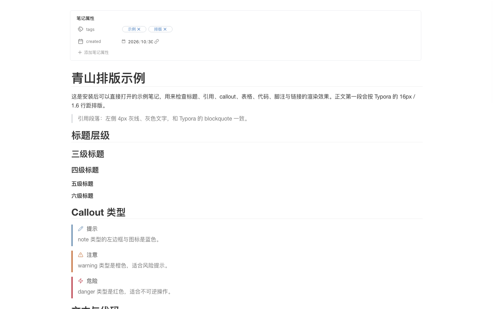
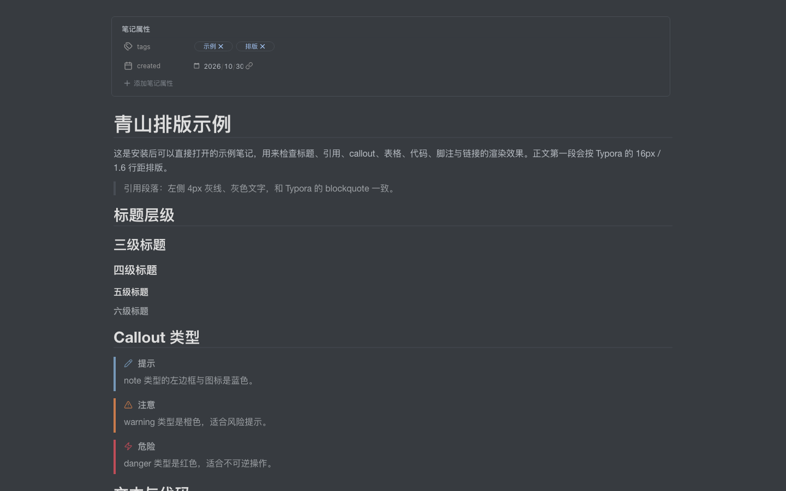

# 青山 · Typora 正文排版

Typora-inspired reading typography for Obsidian. Keep Obsidian's wikilinks, embeds, and block references, while getting Typora's calm reading rhythm.





## Features

- **Responsive reading width**: 860px by default, 1024px on windows ≥1400px, 1200px on windows ≥1800px. Fixed-width and full-width modes are also available.
- **Typora metrics**: 16px body text, 1.6 line height, 30px side padding, Typora heading scale and rule lines.
- **Typora code blocks**: 14.4px / 23.04px code line boxes, `#f8f8f8` surface, 1px border, 8/6 padding, automatic wrapping, and the Typora `cm-s-inner` palette.
- **Dark mode**: follows `theme-dark` automatically with a Typora `night`-inspired surface, text, table, code, and callout palette.
- **Semantic callouts**: note / warning / danger keep Obsidian's `--callout-color` on the left border and icon.
- **Optional accessibility**: an opt-in high-contrast toggle for links, quotes, and metadata.
- **Code-font switch**: use Typora's Courier stack or follow your Obsidian monospace font.
- **No note changes**: links, embeds, block IDs, properties, and source text stay untouched.

## Install

### Community plugins

Once the plugin appears in the Obsidian community directory:

1. Settings → Community plugins → Browse.
2. Search for **青山** or **Typora**.
3. Install and enable **青山 · Typora 正文排版**.

### Manual

1. Download `main.js`, `manifest.json`, and `styles.css` from the latest GitHub release.
2. Put them in:

   ```
   <vault>/.obsidian/plugins/qing-shan-typora/
   ```

3. Reload Obsidian, then enable the plugin in Settings → Community plugins.

## Settings

| Setting | Default | Notes |
|---|---|---|
| Enable typography | On | Toggle the whole plugin. |
| Reading width | Typora auto | 860 / 1024 / 1200 by window; fixed and full modes available. |
| Unified shell | On | Light: `#fafafa` sidebar / `#ffffff` paper. Dark: `#2f3439` / `#363b40`. |
| Hide inline title | On | Hides Obsidian's inline filename; write an H1 in the note instead. |
| Code font | Typora | `Lucida Console`, `Consolas`, `Courier`; or follow Obsidian. |
| High contrast | Off | AA contrast for links, quotes, and metadata; deviates from Typora colors. |
| Font size | 16px | 14–22px. |
| Max content width | 800px | 480–1200px, used by fixed-width mode. |
| Line height | 1.6 | 1.4–2.2. |
| Reset | — | Restore all defaults. |

The settings UI is in Chinese; the plugin itself has no language-dependent behavior.

## Compatibility

- Obsidian **1.5.0+**, desktop only.
- Applies to **Reading view** and **Live Preview**; Source mode is left untouched.
- Works with light and dark themes. [Minimal](https://github.com/kepano/obsidian-minimal) is recommended but not required.
- CSS-only layout; no build step is required to use the release files.

## Privacy

The plugin does not read, search, rewrite, or scan notes, and it makes no network requests. It only:

- reads and writes its own settings through `loadData` / `saveData`;
- adds its own classes and CSS variables to the window `body`;
- removes those classes and variables when disabled or unloaded.

No note content, file names, or vault metadata are collected.

## Development

- `main.js` is plain CommonJS and only requires `obsidian`.
- `styles.css` contains the entire visual layer.
- `versions.json` maps releases to the minimum Obsidian version.

## 中文说明

把 `main.js`、`manifest.json`、`styles.css` 放到 `<库>/.obsidian/plugins/qing-shan-typora/`，重载 Obsidian 后在第三方插件中启用。默认使用 Typora 的 860 / 1024 / 1200 三档宽度、1.6 行距、隐藏顶部文件名和 Typora 代码配色；深色模式自动跟随，callout 恢复类型色，代码字体与对比度可在设置中切换。插件不读取笔记内容，也不请求网络。

## License

[MIT](LICENSE)